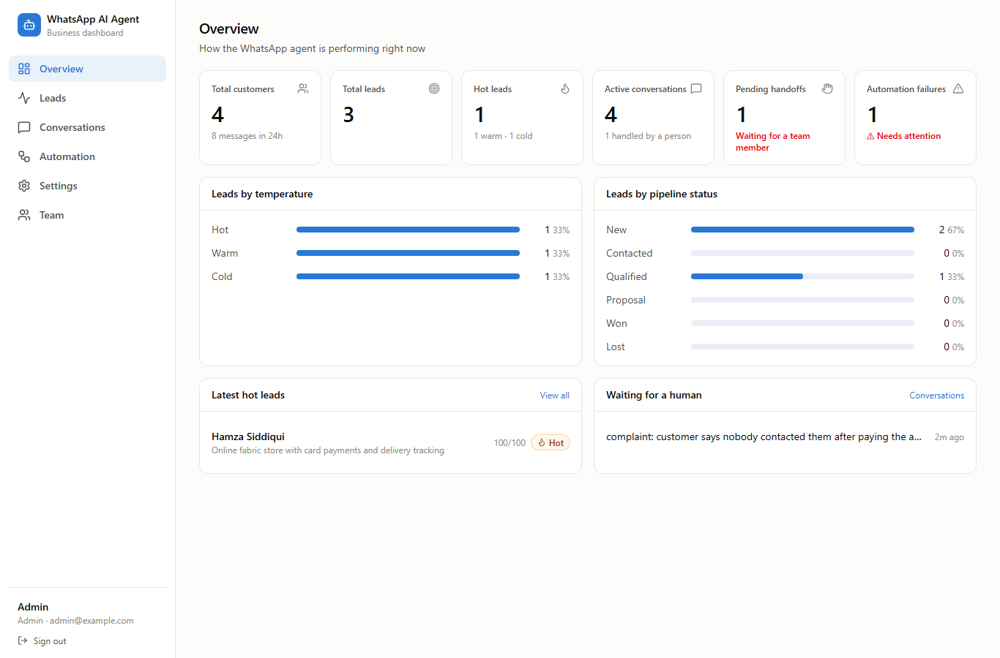
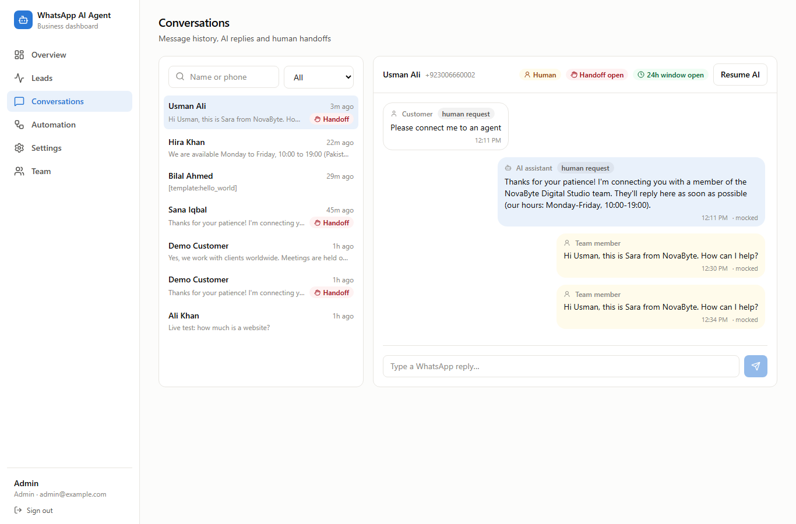

# WhatsApp AI Business Agent

AI-powered WhatsApp business automation: Gemini answers customer questions, qualifies leads as Hot / Warm / Cold, hands complex chats to people, sends compliant follow-ups and recovers from automation errors. The admin dashboard is built with React.

**Stack:** FastAPI · PostgreSQL · SQLAlchemy/Alembic · Gemini · n8n · WhatsApp Cloud API · React + TypeScript + Tailwind · Docker

> 🚧 Work in progress, built in stages. The full documentation arrives in Stage 12.

## Project structure
```
frontend/            React admin dashboard
backend/             FastAPI app (business logic + AI modules)
n8n/workflows/       Importable n8n workflow JSON files
database/migrations/ Alembic migrations
database/seed/       Sample data
docs/                Setup, deployment, API and architecture docs
tests/               Automated tests + sample webhook payloads
scripts/             PowerShell helper scripts
```

## Run everything with Docker
```powershell
docker compose --profile full up -d --build    # postgres + backend + dashboard (nginx) + n8n
start http://127.0.0.1:8080                    # dashboard  (n8n: http://127.0.0.1:5690)
```
Production (HTTPS with Caddy, PostgreSQL 17, mock mode refused): see [docs/DEPLOYMENT.md](docs/DEPLOYMENT.md).

## Quick start (development)
```powershell
Copy-Item .env.example .env    # then edit the values in .env
docker compose up -d postgres  # start the database
docker compose ps              # it should say "healthy"

# Backend Python environment (Python 3.12)
python -m venv backend\.venv
backend\.venv\Scripts\python -m pip install -r backend\requirements-dev.txt

.\scripts\db-migrate.ps1       # create tables + load sample data
backend\.venv\Scripts\python -m pytest   # run the tests
.\scripts\start-backend.ps1    # API on http://127.0.0.1:8000  (interactive docs: /docs)
```

## API overview (`/api/v1`)
| Area | Endpoints | Who |
|---|---|---|
| Auth | `POST /auth/login`, `GET /auth/me` | everyone |
| Team | `GET /team` · `POST /team`, `PATCH /team/{id}` | all · admin |
| Customers | `GET /customers`, `GET /customers/{id}` · `PATCH` | all · admin+sales |
| Leads | `GET /leads` (search, filter, sort, paginate), `GET /leads/{id}` · `PATCH` | all · admin+sales |
| Conversations | `GET /conversations`, `GET /{id}` · `POST /{id}/takeover`, `POST /{id}/resume` | all · admin+sales |
| Handoffs | `GET /handoffs` | all |
| Knowledge base | `GET /faqs`, `GET /services` · `POST/PATCH/DELETE` | all · admin |
| Settings | `GET /settings` · `PUT /settings/{key}` | all · admin |
| Dashboard | `GET /stats/overview` · `GET /audit-logs` | all · admin |
| WhatsApp webhook | `GET /webhooks/whatsapp` (Meta verification), `POST` (signed messages and statuses) | Meta (no login) |
| Human reply | `POST /conversations/{id}/reply` (after take over, within 24h) | admin+sales |
| Dev only | `POST /dev/simulate-inbound` (mock mode only) | admin |

### Testing WhatsApp without a phone (mock mode)
`WA_MOCK_MODE=true` (the default) never contacts Meta: outgoing messages are saved with status `mocked`.
```powershell
.\scripts\send-test-webhook.ps1 -Text "How much is a website?"    # signed fake Meta webhook
```
To connect a real Meta test number, see [docs/WHATSAPP_SETUP.md](docs/WHATSAPP_SETUP.md).

## Admin dashboard (React + TypeScript + Tailwind)
```powershell
.\scripts\start-frontend.ps1    # http://127.0.0.1:5173  (log in with ADMIN_EMAIL / ADMIN_PASSWORD from .env)
```
| Page | What you can do |
|---|---|
| **Overview** | Customers, leads, hot leads, active conversations, pending handoffs, automation failures; leads by temperature/status |
| **Leads** | Search, filter, sort; lead detail with AI score + reason, facts, activity timeline; update status / assignee / notes |
| **Conversations** | Full chat history with AI intent, confidence, guardrails, delivery status; **Take over → Reply → Resume AI** |
| **Automation** | n8n workflow status + execution history, automation errors (risk level, retries), follow-up approval queue |
| **Settings** | Business info, AI config, lead/follow-up/handoff rules, FAQ management, services, API connection status |
| **Team** | Add members, change roles (admin / sales agent / viewer), activate / deactivate |

Responsive (phone → desktop), dark mode follows the OS, and no API keys in the browser (the dev server proxies `/api` to FastAPI).

| Overview | Conversation with handoff |
|---|---|
|  |  |

## Automation (n8n)
Four workflows: **incoming message**, **hot lead notification**, **human handoff**, **follow-ups**. They live in `n8n/workflows/`, and setup is in [docs/N8N_SETUP.md](docs/N8N_SETUP.md).
```powershell
.\scripts\import-n8n.ps1   # once, while n8n is stopped
.\scripts\start-n8n.ps1    # http://127.0.0.1:5690  (Meta webhook: /webhook/whatsapp)
```

## Testing
**194 backend tests (94 % coverage) · 18 frontend tests · 13/13 end-to-end checks** through the running n8n + backend + database. Every critical rule was deliberately broken once to prove the tests catch it. Details: [docs/TEST_RESULTS.md](docs/TEST_RESULTS.md).
```powershell
backend\.venv\Scripts\python -m pytest --cov   # backend
cd frontend; npm test; cd ..                    # frontend
.\scripts\run-e2e.ps1                            # end-to-end
```

## Error monitoring & recovery
Failures are grouped, classified and handled: **safe ones retry themselves**, ones that need a fix are **alerted**, and **risky retries need admin approval**. Nothing is ever repeated blindly. See [docs/ERROR_RECOVERY.md](docs/ERROR_RECOVERY.md); demo it with `curl.exe -X POST http://127.0.0.1:5690/webhook/error-drill`.

## AI agent (Gemini)
One inbound message flows through clearly separated modules:

| Module | Job | Uses Gemini? |
|---|---|---|
| **Orchestrator** | Claims the message (no double replies), applies rules, saves everything in one transaction | No: plain code |
| **Support Agent** | Intent + FAQ answer + "needs a human?" | Yes (structured JSON) |
| **Sales Agent** | Answer + one qualifying question + extracts lead facts | Yes (structured JSON) |
| **Lead Qualification** | Hot / Warm / Cold score + reason from transparent rules | No: rules |
| **Guardrails** | Blocks invented prices / discounts | No: rules |

* No `GEMINI_API_KEY`: the agent still works by falling back to FAQ full-text search and handoff to a person.
* Get a free key at https://aistudio.google.com/apikey and put it in `.env`. Don't enable billing without approval.
* ⚠️ **Free tier:** Google may use prompts to improve its products. Use test data only; real customer data needs the paid tier.

```powershell
.\scripts\try-ai.ps1 -Text "I need an online store, budget 1500 USD, start in 2 weeks"
```

Roles: **admin** (everything), **sales_agent** (leads + conversations), **viewer** (read-only).
