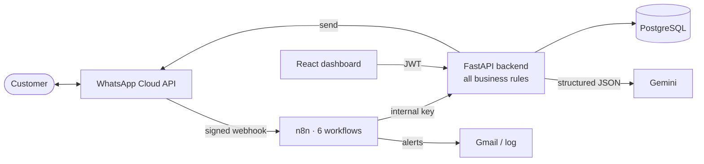
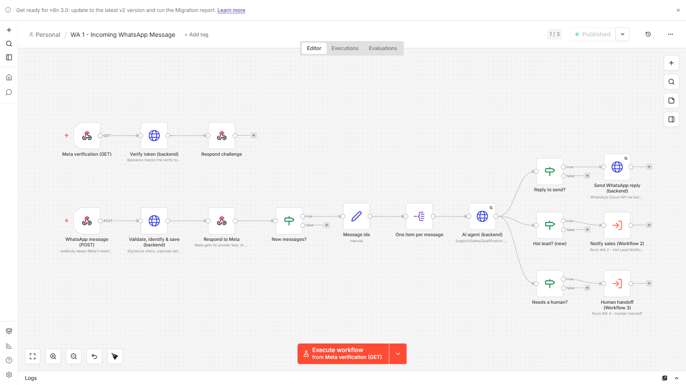
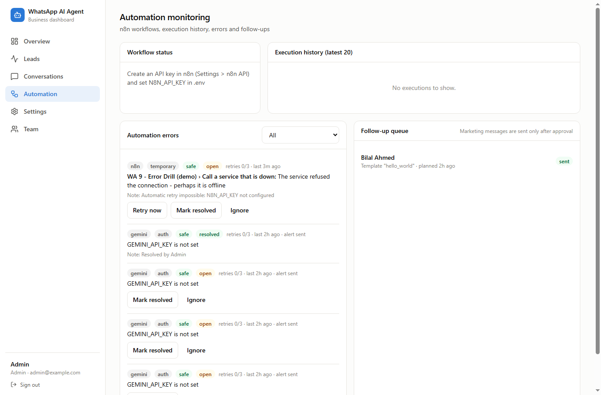
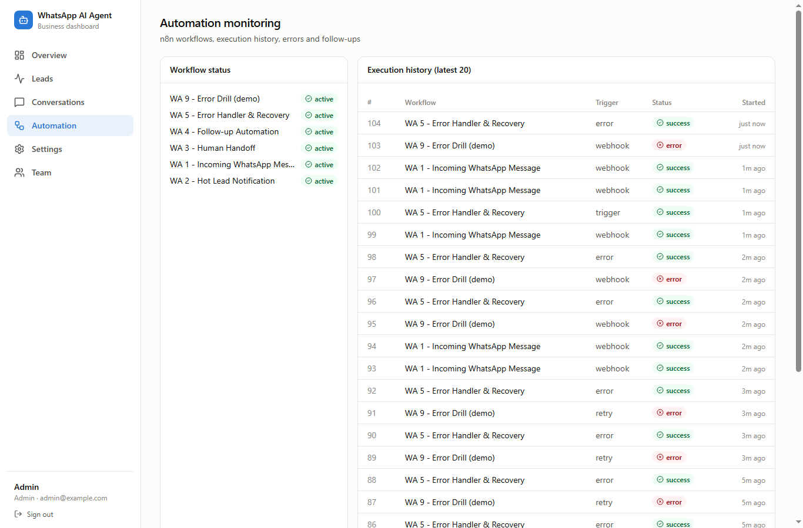

# WhatsApp AI Business Agent

**An AI sales & support agent for WhatsApp that answers customers 24/7, qualifies leads as Hot / Warm / Cold, hands difficult chats to people, follows up within the rules, and recovers from its own failures, without ever sending a message twice.**

`FastAPI` · `PostgreSQL` · `Google Gemini` · `n8n` · `WhatsApp Cloud API` · `React + TypeScript + Tailwind` · `Docker`

**197 backend tests (94% coverage) · 18 frontend tests · 13/13 end-to-end checks against the running stack (local and Docker)**

| Dashboard overview | Conversation with human handoff |
|---|---|
|  |  |

---

## What it does
| For the business | How |
|---|---|
| **Instant answers, day and night** | Gemini answers from the business's own FAQ and price list. Guardrails block invented prices, and FAQ full-text search takes over if the AI is unavailable |
| **Every chat becomes a qualified lead** | The AI extracts needs, budget, timeline and decision-maker; transparent rules score **Hot / Warm / Cold with a written reason**; sales is emailed once when a lead turns hot |
| **People stay in control** | Complaints or "talk to a human" pause the AI, assign the least-busy agent and let them reply from the dashboard; the AI resumes when appropriate |
| **Follow-ups that respect the rules** | Marketing consent (STOP/START), WhatsApp's 24-hour window and templates, and **human approval** before anything is sent |
| **Self-healing automation** | Errors are grouped and classified; safe ones retry with backoff; risky ones (could duplicate a message) need **admin approval**, and every decision is audited |
| **One dashboard** | Overview, Leads, Conversations, Automation monitoring, Settings (FAQ, AI, rules), Team; roles admin / sales agent / viewer |

## Architecture

**n8n** orchestrates (triggers, schedules, notifications). **FastAPI** owns every rule (security, deduplication, AI decisions, consent, recovery), so the rules are typed and tested. **PostgreSQL** constraints guarantee one reply per message even under concurrency. More in [docs/ARCHITECTURE.md](docs/ARCHITECTURE.md).

| n8n: incoming message workflow | Error recovery on the dashboard |
|---|---|
|  |  |

**Live n8n monitoring on the dashboard** (workflow status + execution history, including automatic `retry` runs):



## Quick start (Windows, Docker)
```powershell
git clone <repository-url> whatsapp-ai-business-agent; cd whatsapp-ai-business-agent
Copy-Item .env.example .env                       # fill in random secrets (see docs/SETUP.md)
docker compose --profile full up -d --build       # database + backend + dashboard + n8n
backend\.venv\Scripts\python scripts\demo_data.py # optional demo leads (needs option B's venv)
start http://127.0.0.1:8080                       # log in with ADMIN_EMAIL / ADMIN_PASSWORD
```
WhatsApp runs in **mock mode** by default, so nothing is sent and no account is needed. Without a Gemini key the agent answers from FAQ search. Full guide, including development mode: **[docs/SETUP.md](docs/SETUP.md)**.

## Documentation
| Document | Contents |
|---|---|
| [SETUP.md](docs/SETUP.md) | From zero on Windows: Docker or development mode, demo data, troubleshooting |
| [ARCHITECTURE.md](docs/ARCHITECTURE.md) | Diagrams, message life-cycle, idempotency, error recovery, security, design decisions |
| [API.md](docs/API.md) · [openapi.json](docs/openapi.json) | All 57 endpoints (generated from the code) |
| [DATABASE.md](docs/DATABASE.md) | 13 tables, ER diagram, indexes (generated from the models) |
| [N8N_SETUP.md](docs/N8N_SETUP.md) | The 6 workflows, Gmail, connecting Meta; screenshots in `docs/screenshots/n8n/` |
| [WHATSAPP_SETUP.md](docs/WHATSAPP_SETUP.md) | Meta app, test number, webhook, permanent token, production |
| [ERROR_RECOVERY.md](docs/ERROR_RECOVERY.md) | How failures are classified, retried or escalated |
| [DEPLOYMENT.md](docs/DEPLOYMENT.md) | Docker Compose, production with Caddy HTTPS, backups, checklist |
| [TEST_RESULTS.md](docs/TEST_RESULTS.md) · [E2E](docs/TEST_RESULTS_E2E.md) | Test suites, coverage, bugs found by testing |
| [REQUIREMENTS.md](docs/REQUIREMENTS.md) | Every requirement → implementation → evidence |
| [PORTFOLIO.md](docs/PORTFOLIO.md) · [LOOM_SCRIPT.md](docs/LOOM_SCRIPT.md) | Project description, CV bullets, interview Q&A, demo video script |

## Testing
```powershell
backend\.venv\Scripts\python -m pytest --cov     # 197 tests, real PostgreSQL test database
cd frontend; npm test; cd ..                     # 18 tests
.\scripts\run-e2e.ps1                            # 13 checks through n8n -> backend -> DB
```
Every critical rule (signature check, safe retries, human mode, price guardrail, risky-retry approval, error grouping, atomic claim) was **deliberately broken once to prove the tests catch it**.

## Security highlights
HMAC-SHA256 webhook signatures over the raw bytes · bcrypt passwords, short-lived JWT, server-side roles, audit log · secrets only in `.env` (never in code, Git, the frontend or workflow JSON) · CSP and security headers · production publishes only ports 80/443 via Caddy · AI output validated by Pydantic and price-checked.

## Project structure
```
backend/           FastAPI app: api/, ai/ (agents, orchestrator, guardrails), services/ (whatsapp, messaging, followups, recovery), models/
frontend/          React dashboard (Vite, TypeScript, Tailwind, TanStack Query)
n8n/workflows/     6 importable workflows (generated by scripts/build_n8n_workflows.py)
database/          Alembic migrations + seed data
docker/, deploy/   nginx, entrypoints, n8n import, Caddyfile, backups
tests/             backend (pytest), e2e, fixtures
scripts/           PowerShell + Python helpers (start, import, demo data, e2e, docs generator)
docs/              everything above
```

## Status & honest scope
Complete and tested with **mock WhatsApp** and a **fake Gemini** that follows the real SDK interface; n8n monitoring and automatic retries are verified live against the real n8n API. Going live needs a Meta WhatsApp Business account and a Gemini key (free test tiers are documented), plus a server for production. **No paid service is enabled by this project.**
