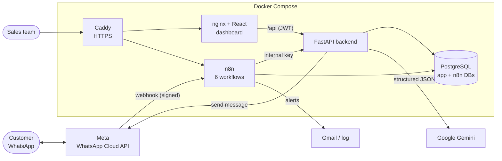
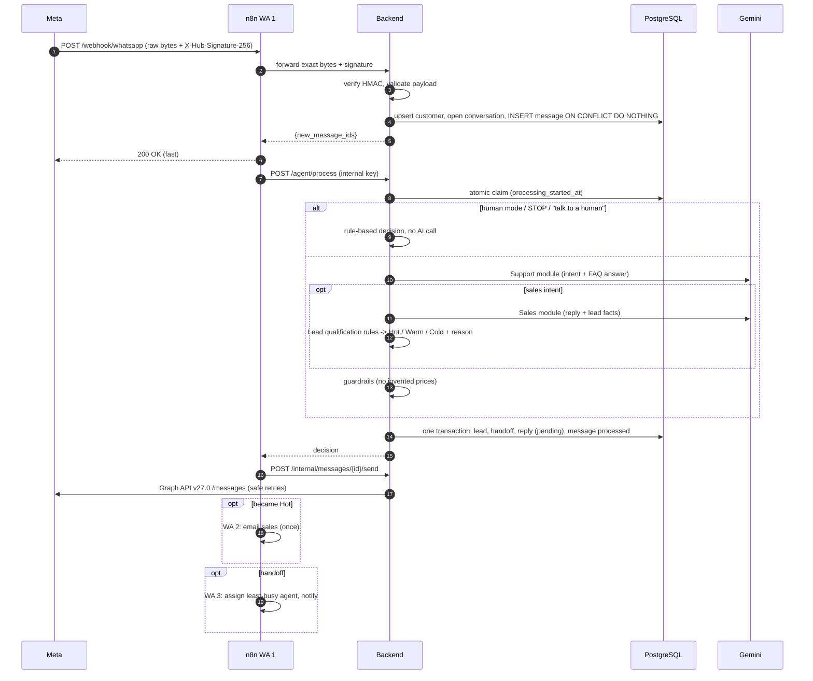
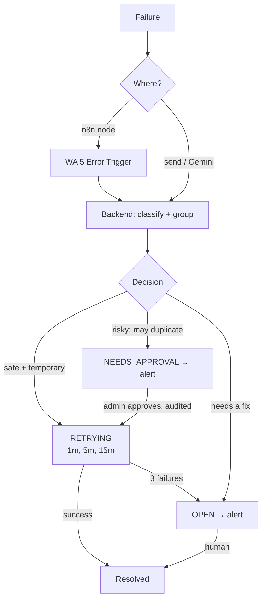

# Architecture

## 1. System overview

| Part | Responsibility | Why this choice |
|---|---|---|
| **n8n** | Triggers, order of steps, schedules, retries, notifications | Visual and easy for a business to adjust; good at plumbing |
| **FastAPI backend** | **Every business rule**: security, deduplication, AI decisions, consent, retries, recovery | Rules live in typed, tested Python (197 tests), not hidden in workflow nodes |
| **PostgreSQL** | Source of truth; constraints enforce invariants (one open conversation, unique `wa_message_id`) | The database, not luck, prevents duplicates even under concurrency |
| **Gemini** | Language only: intent, answers, fact extraction, as JSON validated by Pydantic | Decisions (Hot/Warm/Cold, prices) stay in deterministic code |
| **React dashboard** | Humans see, approve and take over | Calls only the backend; never holds API keys |

## 2. Life of one customer message

## 3. Never repeat blindly: idempotency at every step
| Step | Duplicate source | Protection |
|---|---|---|
| Webhook | Meta retries up to 7 days | `UNIQUE(wa_message_id)` + `ON CONFLICT DO NOTHING` |
| AI processing | n8n retry, parallel calls | Atomic claim; a repeat call returns the stored decision |
| Sending | n8n retry | Send endpoint claims a `pending` message once |
| WhatsApp API failure | Timeout after sending | Only retried if Meta **certainly** did not accept it; otherwise human approval |
| Follow-ups | Hourly runs | `idempotency_key` per follow-up number + `FOR UPDATE SKIP LOCKED` |
| Hot-lead email | Repeated qualification | Only on the change to Hot + "already notified" check |
| Error alerts | Same failure many times | Fingerprint grouping → one row ×N, one alert |

## 4. Error recovery

## 5. Security
- **Webhook:** verify token (GET), HMAC-SHA256 over the raw bytes with the App secret (POST), constant-time comparison, 3 MB limit.
- **Dashboard:** bcrypt passwords, short-lived JWT, user re-checked on every request, roles enforced server-side, audit log, failed logins recorded.
- **Machine-to-machine:** n8n → backend uses a shared internal key, stored encrypted in n8n.
- **Secrets:** only in `.env`, never in code, Git, frontend or workflow JSON (checked before every commit).
- **Network (production):** only Caddy (80/443) is public; CSP and security headers; `/docs` hidden; mock mode refused.
- **AI:** customer text treated as data (prompt-injection rule), structured output validated, prices checked against the catalog.

## 6. Key design decisions
1. **Orchestrator is plain code, not an autonomous agent.** It is predictable, testable, and explainable to a founder.
2. **The LLM extracts facts; rules score the lead.** A customer cannot talk the system into "Hot".
3. **Graceful degradation.** With no Gemini key or during an outage, answers come from FAQ full-text search, otherwise the chat goes to a human. The business never goes silent.
4. **Insertion order (`seq`) for messages.** Meta timestamps have one-second precision and replies use the server clock, so ordering by time mixes two clocks.
5. **Repository = source of truth for workflows.** The JSON is generated by `scripts/build_n8n_workflows.py` and imported automatically when it changes.
