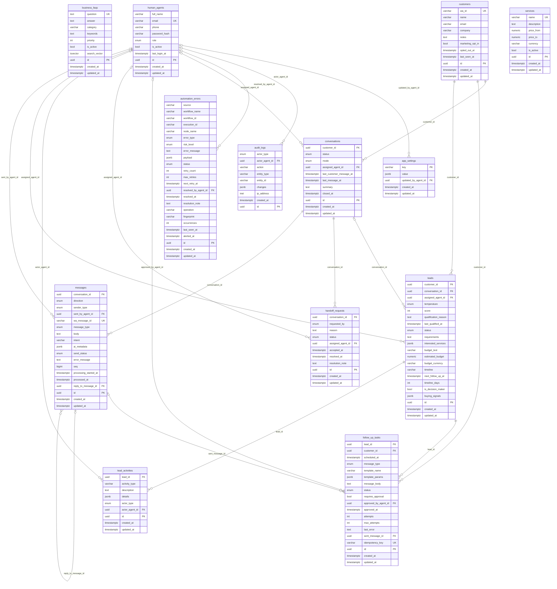

# Database schema

_Generated from the SQLAlchemy models by `scripts/generate_docs.py`. Changes are applied with Alembic migrations in `database/migrations/versions/` (0001 initial, 0002 AI processing + lead signals + message order, 0003 error recovery)._

PostgreSQL 16/17 · **13 tables** · UUID primary keys · `created_at`/`updated_at` on every table (audit_logs is append-only).

## Entity-relationship diagram

## Tables

### `business_faqs`

| Column | Type | Null | Notes |
|---|---|---|---|
| `question` | text | no | unique |
| `answer` | text | no |  |
| `category` | varchar | no |  |
| `keywords` | text | yes |  |
| `priority` | int | no |  |
| `is_active` | bool | no |  |
| `search_vector` | tsvector | no | computed by PostgreSQL |
| `id` | uuid | no | primary key |
| `created_at` | timestamptz | no |  |
| `updated_at` | timestamptz | no |  |

Indexes: `ix_business_faqs_category_active` (category, is_active) · `ix_business_faqs_search_vector` (search_vector)

### `customers`

| Column | Type | Null | Notes |
|---|---|---|---|
| `wa_id` | varchar | no | unique |
| `name` | varchar | yes |  |
| `email` | varchar | yes |  |
| `company` | varchar | yes |  |
| `notes` | text | yes |  |
| `marketing_opt_in` | bool | no |  |
| `opted_out_at` | timestamptz | yes |  |
| `last_seen_at` | timestamptz | yes |  |
| `id` | uuid | no | primary key |
| `created_at` | timestamptz | no |  |
| `updated_at` | timestamptz | no |  |

### `human_agents`

| Column | Type | Null | Notes |
|---|---|---|---|
| `full_name` | varchar | no |  |
| `email` | varchar | no | unique |
| `phone` | varchar | yes |  |
| `password_hash` | varchar | no |  |
| `role` | enum | no | one of: `admin`, `sales_agent`, `viewer` |
| `is_active` | bool | no |  |
| `last_login_at` | timestamptz | yes |  |
| `id` | uuid | no | primary key |
| `created_at` | timestamptz | no |  |
| `updated_at` | timestamptz | no |  |

### `services`

Service catalog. The Sales Agent may only quote prices that exist here.

| Column | Type | Null | Notes |
|---|---|---|---|
| `name` | varchar | no | unique |
| `description` | text | no |  |
| `price_from` | numeric | yes |  |
| `price_to` | numeric | yes |  |
| `currency` | varchar | no |  |
| `is_active` | bool | no |  |
| `id` | uuid | no | primary key |
| `created_at` | timestamptz | no |  |
| `updated_at` | timestamptz | no |  |

### `app_settings`

Key/value settings editable on the dashboard (business info, AI config, ...).

| Column | Type | Null | Notes |
|---|---|---|---|
| `key` | varchar | no | primary key |
| `value` | jsonb | no |  |
| `updated_by_agent_id` | uuid | yes | → `human_agents.id` (SET NULL) |
| `created_at` | timestamptz | no |  |
| `updated_at` | timestamptz | no |  |

### `audit_logs`

Append-only history of who changed what. No updated_at: rows are never edited.

| Column | Type | Null | Notes |
|---|---|---|---|
| `actor_type` | enum | no | one of: `ai`, `agent`, `system`, `n8n`, `customer` |
| `actor_agent_id` | uuid | yes | → `human_agents.id` (SET NULL) |
| `action` | varchar | no |  |
| `entity_type` | varchar | no |  |
| `entity_id` | varchar | yes |  |
| `changes` | jsonb | yes |  |
| `ip_address` | inet | yes |  |
| `created_at` | timestamptz | no |  |
| `id` | uuid | no | primary key |

Indexes: `ix_audit_logs_entity` (entity_type, entity_id) · `ix_audit_logs_actor_agent` (actor_agent_id) · `ix_audit_logs_created` (created_at)

### `automation_errors`

| Column | Type | Null | Notes |
|---|---|---|---|
| `source` | varchar | no |  |
| `workflow_name` | varchar | yes |  |
| `workflow_id` | varchar | yes |  |
| `execution_id` | varchar | yes |  |
| `node_name` | varchar | yes |  |
| `error_type` | enum | no | one of: `temporary`, `rate_limit`, `auth`, `validation`, `unknown` |
| `risk_level` | enum | no | one of: `safe`, `risky` |
| `error_message` | text | no |  |
| `payload` | jsonb | yes |  |
| `status` | enum | no | one of: `open`, `retrying`, `needs_approval`, `resolved`, `ignored` |
| `retry_count` | int | no |  |
| `max_retries` | int | no |  |
| `next_retry_at` | timestamptz | yes |  |
| `resolved_by_agent_id` | uuid | yes | → `human_agents.id` (SET NULL) |
| `resolved_at` | timestamptz | yes |  |
| `resolution_note` | text | yes |  |
| `operation` | varchar | yes |  |
| `fingerprint` | varchar | yes |  |
| `occurrences` | int | no |  |
| `last_seen_at` | timestamptz | yes |  |
| `alerted_at` | timestamptz | yes |  |
| `id` | uuid | no | primary key |
| `created_at` | timestamptz | no |  |
| `updated_at` | timestamptz | no |  |

Indexes: `ix_automation_errors_retry_due` (status, next_retry_at) · `ix_automation_errors_status_created` (status, created_at) · `uq_automation_errors_open_fingerprint` (fingerprint, unique, where status IN ('open', 'retrying', 'needs_approval')) · `uq_automation_errors_execution_node` (execution_id, node_name, unique, where execution_id IS NOT NULL)

### `conversations`

| Column | Type | Null | Notes |
|---|---|---|---|
| `customer_id` | uuid | no | → `customers.id` (CASCADE) |
| `status` | enum | no | one of: `open`, `closed` |
| `mode` | enum | no | one of: `ai`, `human` |
| `assigned_agent_id` | uuid | yes | → `human_agents.id` (SET NULL) |
| `last_customer_message_at` | timestamptz | yes |  |
| `last_message_at` | timestamptz | yes |  |
| `summary` | text | yes |  |
| `closed_at` | timestamptz | yes |  |
| `id` | uuid | no | primary key |
| `created_at` | timestamptz | no |  |
| `updated_at` | timestamptz | no |  |

Indexes: `ix_conversations_customer_status` (customer_id, status) · `ix_conversations_status_last_message` (status, last_message_at) · `uq_conversations_one_open_per_customer` (customer_id, unique, where status = 'open')

### `handoff_requests`

| Column | Type | Null | Notes |
|---|---|---|---|
| `conversation_id` | uuid | no | → `conversations.id` (CASCADE) |
| `requested_by` | enum | no | one of: `ai`, `agent`, `system`, `n8n`, `customer` |
| `reason` | text | no |  |
| `status` | enum | no | one of: `pending`, `accepted`, `resolved`, `cancelled` |
| `assigned_agent_id` | uuid | yes | → `human_agents.id` (SET NULL) |
| `accepted_at` | timestamptz | yes |  |
| `resolved_at` | timestamptz | yes |  |
| `resolution_note` | text | yes |  |
| `id` | uuid | no | primary key |
| `created_at` | timestamptz | no |  |
| `updated_at` | timestamptz | no |  |

Indexes: `uq_handoff_requests_one_active_per_conversation` (conversation_id, unique, where status IN ('pending', 'accepted')) · `ix_handoff_requests_status_created` (status, created_at)

### `leads`

| Column | Type | Null | Notes |
|---|---|---|---|
| `customer_id` | uuid | no | → `customers.id` (CASCADE); unique |
| `conversation_id` | uuid | yes | → `conversations.id` (SET NULL) |
| `assigned_agent_id` | uuid | yes | → `human_agents.id` (SET NULL) |
| `temperature` | enum | no | one of: `hot`, `warm`, `cold` |
| `score` | int | no |  |
| `qualification_reason` | text | yes |  |
| `last_qualified_at` | timestamptz | yes |  |
| `status` | enum | no | one of: `new`, `contacted`, `qualified`, `proposal`, `won`, `lost` |
| `requirements` | text | yes |  |
| `interested_services` | jsonb | yes |  |
| `budget_text` | varchar | yes |  |
| `estimated_budget` | numeric | yes |  |
| `budget_currency` | varchar | yes |  |
| `timeline` | varchar | yes |  |
| `next_follow_up_at` | timestamptz | yes |  |
| `timeline_days` | int | yes |  |
| `is_decision_maker` | bool | yes |  |
| `buying_signals` | jsonb | yes |  |
| `id` | uuid | no | primary key |
| `created_at` | timestamptz | no |  |
| `updated_at` | timestamptz | no |  |

Indexes: `ix_leads_assigned_agent` (assigned_agent_id) · `ix_leads_temperature` (temperature) · `ix_leads_status` (status)

### `messages`

| Column | Type | Null | Notes |
|---|---|---|---|
| `conversation_id` | uuid | no | → `conversations.id` (CASCADE) |
| `direction` | enum | no | one of: `inbound`, `outbound` |
| `sender_type` | enum | no | one of: `customer`, `ai`, `human`, `system` |
| `sent_by_agent_id` | uuid | yes | → `human_agents.id` (SET NULL) |
| `wa_message_id` | varchar | yes | unique |
| `message_type` | enum | no | one of: `text`, `template`, `interactive`, `image`, `document`, `audio`, `other` |
| `body` | text | yes |  |
| `intent` | varchar | yes |  |
| `ai_metadata` | jsonb | yes |  |
| `send_status` | enum | no | one of: `received`, `pending`, `sent`, `delivered`, `read`, `failed`, `mocked` |
| `error_message` | text | yes |  |
| `seq` | bigint | no |  |
| `processing_started_at` | timestamptz | yes |  |
| `processed_at` | timestamptz | yes |  |
| `reply_to_message_id` | uuid | yes | → `messages.id` (SET NULL) |
| `id` | uuid | no | primary key |
| `created_at` | timestamptz | no |  |
| `updated_at` | timestamptz | no |  |

Indexes: `ix_messages_reply_to` (reply_to_message_id) · `ix_messages_conversation_created` (conversation_id, created_at)

### `follow_up_tasks`

| Column | Type | Null | Notes |
|---|---|---|---|
| `lead_id` | uuid | no | → `leads.id` (CASCADE) |
| `customer_id` | uuid | no | → `customers.id` (CASCADE) |
| `scheduled_at` | timestamptz | no |  |
| `message_type` | enum | no | one of: `text`, `template`, `interactive`, `image`, `document`, `audio`, `other` |
| `template_name` | varchar | yes |  |
| `template_params` | jsonb | yes |  |
| `message_body` | text | yes |  |
| `status` | enum | no | one of: `pending_approval`, `approved`, `sent`, `failed`, `cancelled`, `skipped` |
| `requires_approval` | bool | no |  |
| `approved_by_agent_id` | uuid | yes | → `human_agents.id` (SET NULL) |
| `approved_at` | timestamptz | yes |  |
| `attempts` | int | no |  |
| `max_attempts` | int | no |  |
| `last_error` | text | yes |  |
| `sent_message_id` | uuid | yes | → `messages.id` (SET NULL) |
| `idempotency_key` | varchar | no | unique |
| `id` | uuid | no | primary key |
| `created_at` | timestamptz | no |  |
| `updated_at` | timestamptz | no |  |

Indexes: `ix_follow_up_tasks_status_scheduled` (status, scheduled_at) · `ix_follow_up_tasks_lead` (lead_id)

### `lead_activities`

| Column | Type | Null | Notes |
|---|---|---|---|
| `lead_id` | uuid | no | → `leads.id` (CASCADE) |
| `activity_type` | varchar | no |  |
| `description` | text | no |  |
| `details` | jsonb | yes |  |
| `actor_type` | enum | no | one of: `ai`, `agent`, `system`, `n8n`, `customer` |
| `actor_agent_id` | uuid | yes | → `human_agents.id` (SET NULL) |
| `id` | uuid | no | primary key |
| `created_at` | timestamptz | no |  |
| `updated_at` | timestamptz | no |  |

Indexes: `ix_lead_activities_lead_created` (lead_id, created_at)
